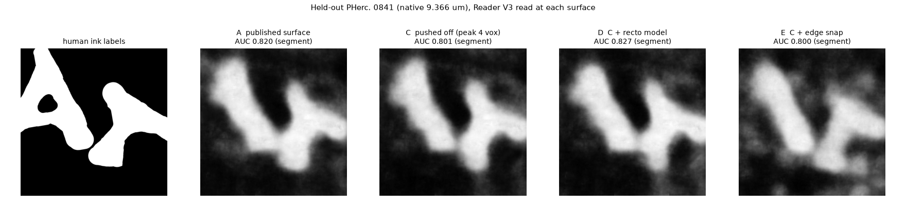
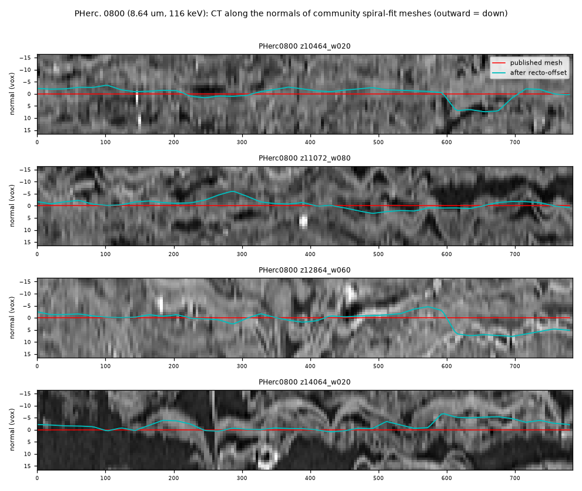

# recto-offset

A small model that moves a surface mesh along its normals back onto its sheet, and the label generator it was
trained with. Labels: PHerc. Paris 4 verified patches pushed off their sheet on purpose, with the offset back as
the target, following Sean Johnson's suggestion (Vesuvius Challenge Discord, #general, 14 October 2026). One command
corrects any tifxyz mesh on any open-data scan:

```bash
python -m recto.apply in.tifxyz out.tifxyz --volume https://vesuvius-challenge-open-data.s3.us-east-1.amazonaws.com/PHerc0139/volumes/20250728140407-9.362um-1.2m-113keV-masked.zarr/0
```

## Results (21 October 2026; test and bars fixed beforehand in [PREREG.md](PREREG.md))

**1. Held-out PHerc. Paris 4 (z 10000-11500, never used for training or choosing the model).** Surfaces pushed off
by a smooth field of the given peak size, share of nodes within 2 voxels of the verified surface after correction:

| push | recto model | best model-free snap | leave in place |
|---|---|---|---|
| 4 voxels | **86.0 %** | 58.1 % | 51.5 % |
| 6 voxels | **77.9 %** | 51.9 % | 30.5 % |
| 8 voxels | **70.2 %** | 42.5 % | 24.0 % |
| none (a good surface) | 93.0 % within 1 voxel | | 100 % |

Both pre-set bars pass: at least 10 points over the best snap at 4-8 voxels (it is 26-28), and at least 90 % of a
good surface left within 1 voxel.

**2. Another scan: PHerc. 0139 at its native 9.362 µm, 113 keV** (the scan type of the First Letters scrolls; 19
curated segments, 38 windows, nothing from this scroll used anywhere in training). Pushed surfaces: 63.8 / 58.5 /
50.7 % within 2 voxels at 4 / 6 / 8 voxels, against 51.5 / 39.3 / 32.5 % for the best snap (+12 to +19 points;
bar 1 passes). On the curated surfaces as published, the model moves whole regions by about 1 voxel (45 % of
nodes stay within 1 voxel; bar 2 fails). The ink test below asks whether those moves matter.

**3. Ink: held-out PHerc. 0841 at 9.366 µm** (no public ink model was trained on PHerc. 0841). 12 tiles chosen from
the labels only; Reader V3 read at each surface; human-label AUC, paired block bootstrap (95 % interval):

| comparison | Reader V3 AUC change | Reader v2 |
|---|---|---|
| pushed surface corrected by the model vs left pushed | **+0.016** [+0.003, +0.028] | -0.003 [-0.013, +0.008] |
| model vs edge snap, same pushed surface | **+0.065** [+0.034, +0.090] | +0.051 [+0.022, +0.080] |
| edge snap vs left pushed | -0.049 [-0.080, -0.019] | -0.055 [-0.084, -0.028] |
| model on the published surfaces vs as published | +0.006 [-0.005, +0.017] | +0.000 [-0.009, +0.011] |

Snapping to the CT edge costs ink; the model does not, recovers part of what a bad surface loses, and leaves the
ink of published surfaces unchanged within noise (slightly up on 2 of 3 segments). So its ~1-voxel moves on curated
native-scan surfaces (result 2) do not hurt what an ink model reads.



## v1.1 (22 October 2026): native-scan training, larger errors, real First Letters meshes

A second model, r3 (`weights/recto_offset_r3.pt`), adds curated and automatic segments on native 9.362 µm scans
(PHerc. 0139, 0500P2) to training and pushes of up to 12 voxels; it was chosen over r2 on a combined Paris 4 +
PHerc. 0814 validation set, as fixed in [PREREG.md](PREREG.md) (amendment 3) before training.

**New held-out scan: PHerc. 0009B at its native 8.64 µm, 116 keV** (the scan class of most First Letters
scrolls; automatically grown meshes; never used for training or choice). Share within 2 voxels after correction:

| push | r3 | r2 | best snap | leave in place |
|---|---|---|---|---|
| 4 voxels | 55.7 % | **59.8 %** | 51.5 % | 51.5 % |
| 6 voxels | **49.0 %** | 48.6 % | 35.6 % | 30.5 % |
| 8 voxels | 46.3 % | **46.4 %** | 29.1 % | 24.0 % |
| 10 voxels | **39.7 %** | 33.9 % | 25.0 % | 18.9 % |
| 12 voxels | **40.0 %** | 31.6 % | 24.5 % | 18.5 % |
| none (within 1 voxel) | 46.6 % | 47.8 % | | 100 % |

Both models beat the best snap by 13 to 17 points from 6 voxels up; at 4 voxels the gain is 4 (r3) and 8 (r2)
points, under the pre-set 10, and both move these surfaces by about a voxel at rest (pre-set bar failed). On the
Paris 4 test band r3 is better than r2 for large errors (60.8 vs 55.3 % at 10 voxels, 49.0 vs 41.0 % at 12) and
worse for small ones (78.5 vs 86.0 % at 4). Training on native scans did not remove the ~1-voxel moves at rest.

**Real First Letters meshes.** 12 community spiral-fit windings of PHerc. 0800 (8.64 µm, 116 keV; pscamillo's
vesuvius-eligible-meshes), one 800 x 800-voxel crop each, corrected with r3. Measure: share of nodes whose brightest
layer within +-6 voxels lies within 2 voxels of the surface (a CT feature, not ground truth). For scale: Paris 4
verified patches score 50.9 %, curated PHerc. 0139 segments 43.4 %, ~~a random position 38.5 %~~ chance 32.9 %
(**corrected in v1.2**: 38.5 % was 5/13, an even spread of the brightest layer over the window, not a measurement;
32.9 % is measured with random shifts along the normals on the same crops, `results/demo_pherc0800_null.json`).

| | share within 2 voxels of the bright layer |
|---|---|
| published meshes | 32.9 % (at chance; ~~below random: they tend to sit between sheets~~, corrected in v1.2) |
| after recto-offset (r3) | **39.5 %** (6.6 points above chance; higher on all 12 meshes; median move 1.8 voxels) |



**Which model.** r2 (default) for meshes that are roughly on their sheet; r3 (`--ckpt weights/recto_offset_r3.pt`)
for automatic or spiral-fit meshes that may be 6 or more voxels off.

**Where to use it.** On meshes that may sit off their sheet (automatic traces, spiral-fit windings, meshes moved
between scans): it brings them back better than any CT snap tried here. On curated meshes it is not needed and may
move them by about a voxel without changing their ink.

## v1.2 (23 October 2026): a correction, an optional gate, a second pass, ScrollFiesta OBJ meshes

**Correction.** v1.1 said the 12 published PHerc. 0800 meshes (32.9 % of nodes within 2 voxels of the bright layer)
were "below random (38.5 %)". That 38.5 % was 5/13, the share if the brightest layer were spread evenly over the 13
positions of the window; it was never measured. Measured on the same 12 crops with the same code, each node shifted
by its own random amount along its normal (uniform +-6 voxels, 5 seeds; `recto/demo_null.py`), chance is 32.9 %
(32.8-32.9 % over seeds; +-4.5 voxels gives the same). So the published meshes sit at chance, not below it, and r3
(39.5 %) is 6.6 points above chance, about a third of the way to Paris 4 verified patches (50.9 %). The v1.1 text
above is corrected in place; `results/demo_pherc0800_null.json`, [PREREG.md](PREREG.md) amendment 4.

**Gate: `--min-snr Z`** (off by default; v1.1 behaviour unchanged). A node keeps its position unless
|offset| >= Z x b, where b is the model's predicted Laplace scale in voxels (b = 1 / `confidence.tif`); `gate.tif`
records which nodes moved. Z was fixed by a rule stated in amendment 4: the smallest Z in {0, 1, 1.5, 2, 3} that
keeps at least 85 % of nodes within 1 voxel at rest on the PHerc. 0814 validation scan. That gives **Z = 2 for r2**
and **Z = 3 for r3**. The gate was explored after the v1.1 results were known, so the numbers on the test scans
below are post hoc (`recto/gate_eval.py`, same crops and seeds as `recto/evaluate.py`; `results/v12_gating.json`).

| scan | model, Z | at rest: within 1 voxel | push 4: within 2 | push 8 | push 12 | best baseline at 4 / 8 / 12 |
|---|---|---|---|---|---|---|
| PHerc. 0814 (validation; sets Z) | r2, Z = 2 | 45.0 → **85.6** | 65.0 → 60.6 | 44.8 → 38.5 | 28.8 → 25.4 | 51.5 / 29.2 / 22.8 |
|  | r3, Z = 3 | 44.4 → **94.2** | 60.5 → 51.4 | 41.6 → 30.7 | 34.4 → 26.9 |  |
| PHerc. 0009B (held out; post hoc) | r2, Z = 2 | 47.8 → **78.8** | 59.8 → 56.1 | 46.4 → 43.1 | 31.6 → 27.6 | 51.5 / 29.1 / 24.5 |
|  | r3, Z = 3 | 46.6 → **90.0** | 55.7 → 50.4 | 46.3 → 34.4 | 40.0 → 28.7 |  |
| PHerc. 0139 (post hoc) | r2, Z = 2 | 45.0 → **79.6** | 63.8 → 58.8 | 50.7 → 45.3 | 35.3 → 31.2 | 51.5 / 32.5 / 26.4 |
| Paris 4 test band (post hoc) | r2, Z = 2 | 93.0 → **97.3** | 86.0 → 80.0 | 70.2 → 64.5 | 40.9 → 36.0 | 58.1 / 42.5 / 32.1 |
|  | r3, Z = 3 | 89.6 → **98.7** | 78.5 → 59.4 | 67.4 → 46.4 | 49.0 → 34.3 |  |

Share of nodes, ungated → gated. Best baseline: the better of leaving the surface in place and the best model-free
snap, as pre-registered. At a 4-voxel push on the native scans that is leaving the surface in place (51.5 %; no snap
does as well); the "best snap" figures at 4 voxels in the v1.0/v1.1 text above are this number. On PHerc. 0814, r2 at
Z = 2 keeps 85.6 % of nodes of the published surfaces within 1 voxel (was 45.0 %) and gives up 3 to 7 points on
pushed surfaces. On the held-out PHerc. 0009B (post hoc), r2 at
Z = 2 leaves 78.8 % within 1 voxel and stays 3 to 14 points over the best baseline at 4-12 voxel pushes (4.6 at 4);
r3 at Z = 3 leaves 90.0 % there, but falls below the best baseline at 4 and 6 voxels (50.4 vs 51.5 %, 34.7 vs
35.6 %).

**When to use the gate.** Only for meshes that are already on their sheet (curated or hand-fixed segments), so that
the tool leaves good regions alone and moves only where it is sure. Not for spiral fits or automatic traces: there
the model moves too little rather than too much, and on the 12 PHerc. 0800 crops the gate lowers the gain (r3 39.5 %;
Z = 2: 36.7 %; Z = 3: 35.2 %). No Z in the grid gives both 90 % at rest and 10 points over the best baseline at a
4-voxel push on any native scan the model was not trained on (r3 does on its own training scan PHerc. 0139: 90.4 %
and +15 points at Z = 1.5).

**Second pass: `--iterations 2`** reads the CT again at the corrected surface and adds a second prediction.
Post hoc on every scan, it helps only large errors: with r2 at a 12-voxel push, 40.9 → 49.5 % within 2 voxels on
the Paris 4 test band, 28.8 → 33.3 % on PHerc. 0814, 35.3 → 39.3 % on PHerc. 0139 and 31.6 → 35.1 % on PHerc. 0009B
(r3: 49.0 → 52.8 % and 40.0 → 40.7 % on Paris 4 and 0009B). It costs at rest (r2: 1 to 8 points fewer nodes within
1 voxel) and at 4-voxel pushes (0.6 to 4.5 points); with the gate on, the gain at 12 voxels shrinks to 1-4 points
(r2, Z = 2) or about none (r3, Z = 3).
Use it only for meshes that may be 10 or more voxels off.

**ScrollFiesta meshes: `python -m recto.obj in.obj out.obj --volume <zarr> --umbilicus axis.csv`.** Reads OBJ files
as ScrollFiesta writes them ("v z y x" in voxels, "vt u v" in voxel-sized pixels), rasterises each UV chart onto a
2-voxel grid, runs the same correction as `recto.apply` (same options: `--ckpt`, `--min-snr`, `--iterations`), and
writes the OBJ back with each vertex moved along its normal by the offset interpolated from its chart, plus
`out.offsets.npz` (offset, confidence and moved flag per vertex). `--umbilicus` takes ScrollFiesta's
`configs/axis.csv` (z, y, x rows) as well as `umbilicus.json`. Tested on synthetic meshes only so far. A dry run on
ScrollFiesta's PHerc. 0139 4x5x5 atlas (`atlas_bake.obj`, 98,521 vertices) gives 1.6 million nodes in 592 charts and
needs 228 CT chunks of 128^3 (478 MB) of the 9.362 µm scan 20250728140407. That atlas holds core windings around the
scroll axis, a regime the model was not validated in; use ScrollFiesta's axis there, and r2 (r3 was trained on
PHerc. 0139 segments).

**Fixes.** With `--cache`, the axis estimate stored its coarse (level-4) chunks in the level-0 cache folder, where
their keys could collide with level-0 chunks at the scan corner (outside the scroll; none of them was read for the
PHerc. 0800 demo crops, checked). It now has its own folder (`--axis-cache`, default `<cache>/axis`). Without
`--cache`, v1.1 kept the chunks of every scan in one folder, so a second scan could read the first scan's chunks; the
default is now one folder per volume. Nodes outside the mesh no longer read CT.

## Model-free controls on real meshes (24 October 2026)

The real-mesh measure (share of nodes within 2 voxels of the brightest CT layer) can rise just because every node
moves the same way. So both real-mesh runs were repeated against model-free shifts, with the same nodes, normals and
measure, CPU only, no new CT.

**PHerc. 0800, the 12 community crops above (r3): the gain is per node.** r3 39.5 %; the best constant shift along
the normals, swept from -6 to +6 voxels, 34.3 % (+3.5 voxels); the best constant chosen separately for each crop on
the measure itself (optimistic), 35.9 %; each crop moved by its own median r3 offset, 33.8 %; r3's own offsets
shuffled among the nodes of each crop, 33.5 % (5 seeds). Shuffling keeps 0.5 of r3's 6.5 points. r3 beats the best
per-crop constant by at least 1 point on 9 of 12 crops and ties on 3; one crop (z9264_w020) carries much of the
pooled gain, and without it r3 is still 2.8 points over the most favourable constants. r2 scores 38.8 %.
`results/control_pherc0800.json`, `runs/control_pherc0800.py`.

**ScrollFiesta mesh, PHerc. 0139 (r2, `recto.obj`): neutral.** On ScrollFiesta's 4x5x5 atlas (98,521 vertices,
1.6 million 2-voxel nodes in 589 charts, around the scroll axis), r2 raises the share from 40.5 % to 54.1 % (chance
35.5 %), but moving every node 2 voxels outward with no model gives 55.4 % (on a 200,000-node sample). The
brightest layer sits a median 3 voxels outward of ScrollFiesta's surface, which fits a surface placed at the
dark-to-bright edge; r2 learned the Paris 4 verified placement, about a voxel further out. So on this mesh the tool
mostly changes the placement convention; it does not show a repair. Which placement is better depends on what reads
the surface next (for ink, the Paris 4 A/B above). `results/demo_sf0139.json`, `figures/demo_sf0139_sections.png`,
`recto/demo_obj.py`, `runs/control_sf0139_constant.py`.

The measure is a CT feature the model itself reads, and a snap to the brightest layer would score high by
construction: these controls show that r3's moves are per node and follow the bright layer, not that they are right.

## How

1. `recto/fetch_meshes.py`: a seeded, z-stratified sample of 246 verified patches (6,000 names drawn, up to 12
   patches of at least 1 cm² per 500-slice band).
2. `recto/stacks.py`: two windows of 96 x 96 nodes per patch at 2-voxel spacing; the CT from -24 to +24 voxels along
   the outward normal (9.6 µm level of the 2.4 µm scan). On the verified patches the CT's bright layer lies 0-2 voxels
   outward and the steepest dark-to-bright rise 1-4 voxels inward of the surface.
3. `recto/data.py`: a pair is a crop around the surface pushed off by a smooth random field f (constant part plus
   smoothed noise, up to 8 voxels); the target is -f. No CT is re-sampled for a pair. Training adds generic
   intensity augmentation (gamma, contrast, blur, noise).
4. `recto/model.py`: a 3D stem over the 25 layers and a 2D U-Net over the sheet (542k parameters); offset plus a
   Laplace scale (confidence). 40,000 steps, one RTX 3090, 1.7 h.
5. `recto/evaluate.py`, `recto/baselines.py`, `recto/external.py`, `recto/ink_ab.py`: the three tests above.
6. `recto/apply.py`: the tool. Weights: `weights/recto_offset_r2.pt` (2 MB).
7. v1.2: `recto/obj.py` (OBJ meshes), `recto/gate_eval.py` (the gate and second pass on the frozen crops),
   `recto/demo_null.py` (the measured chance level of the PHerc. 0800 demo).

Dataset: `data/manifest.json` lists every window (scan, patch, position, split); the stacks are rebuilt from the
open data with `fetch_meshes` + `stacks` + `external` (CT is not redistributed). Tests: `python -m pytest tests`
(17, including end-to-end runs of `apply` and `obj` on a synthetic scan).

## Related work

- villa: `lasagna`/`snap_surf` and Erwin Nieuwlaar's `snap_meshes.py` snap to the m7 surface *prediction*, not to
  the CT; `scrollprize/fiber_strip_small_v1` (Sean Johnson, 14 Oct 2026) predicts the sheet's normal offset around a
  traced fiber (Paris 4), so it needs fibers first. This model needs only the mesh and the scan.
- ScrollFiesta (Hari Seldon): `RectoRefine` moves a mesh to the outward dark-to-bright boundary of the CT; Hari set
  the "within about 2 voxels of the recto" bar this work uses.
- Per-tile depth re-centring before ink: tarikcankorkmaz measured an oracle gain (0.785 to 0.896 AUC) with no
  label-free selector; AndreasHad04's label-free depth filter (villa #1898); inkdx's window-scale snap. The ink test
  here is a label-free per-node correction of the surface itself.

## Limits

- Truth on Paris 4 is the verified patch, not an independent recto measurement; the patches sit about 2 voxels
  outward of the CT's dark-to-bright rise. The model reproduces that convention.
- Trained on Paris 4 at 9.6 µm only; on the native 9.36 µm scan it moves good surfaces by about a voxel (result 2).
- Pushes of up to 8 voxels; a surface on the wrong sheet (one pitch or more away) is a sheet switch, not something
  this model is meant to fix.
- The ink test covers one scroll, 12 tiles and two readers; the recovery gain is clear for Reader V3 and absent for
  Reader v2.

## Credits

Sean Johnson (the pushed-surface recipe), Hari Seldon (the recto definition and the 2-voxel bar), the Vesuvius
Challenge team (verified patches, scans, Reader-compatible ink inference), Domenico Russo (Reader v2, Reader V3).
Data: Vesuvius Challenge open data (CC BY-NC 4.0). Code and weights: MIT.

Developed with AI assistance under my direction.
